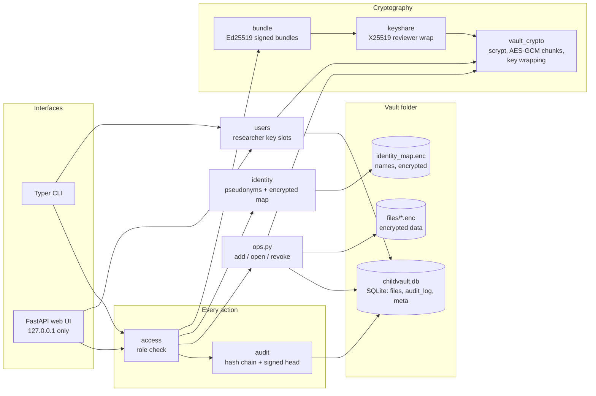
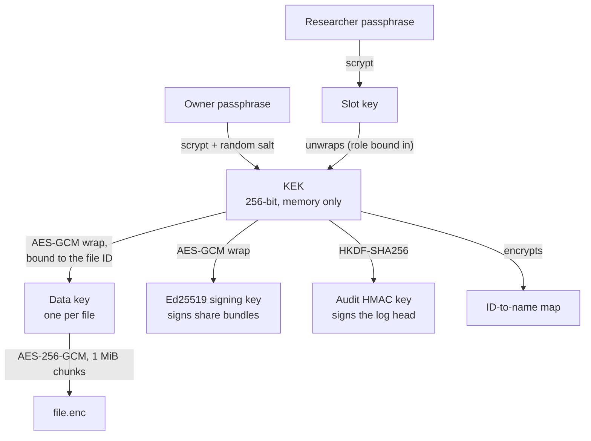
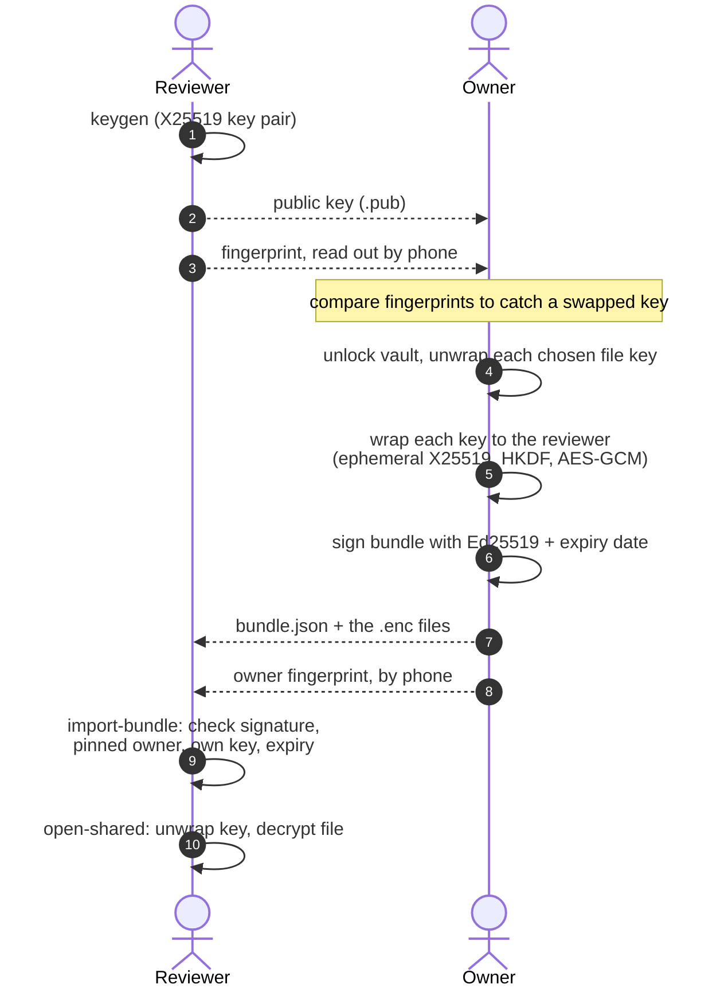
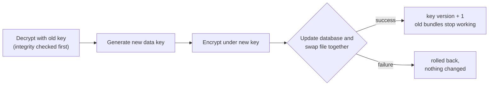
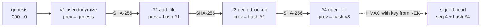

<p align="center">
  
</p>

<p align="center">
  
  
  
  
  
  
</p>

<p align="center">
  <b>An offline vault for sensitive child-behaviour recordings and annotations.</b><br>
  Encrypts every file, hides every child's name behind a pseudonym, shares data with reviewers
  through signed, expiring bundles, logs every action in a hash-chained audit log, and
  <i>proves</i> when someone tampers with any of it.
</p>

<p align="center">
  CS3002 Information Security, Fall 2026 term project<br>
  Mariyam Pasha (23L-0809) · Aaleen Fatima (23L-0652) · Laiba Amjad (23L-0642)
</p>

---

## See it work

<p align="center">
  
</p>

One flipped bit in a stored file and the vault refuses to hand over *any* of it. All demos use synthetic data, never real child data.

---

## Contents

- [Why this exists](#why-this-exists)
- [What you get](#what-you-get)
- [How it works](#how-it-works)
  - [Architecture](#architecture)
  - [Key hierarchy](#key-hierarchy)
  - [Encrypted file format](#encrypted-file-format)
  - [Tamper detection](#tamper-detection)
  - [Sharing with a reviewer](#sharing-with-a-reviewer)
  - [Revocation](#revocation)
  - [Audit log](#audit-log)
  - [Roles and access control](#roles-and-access-control)
- [Quick start](#quick-start)
- [Command reference](#command-reference)
- [Web UI](#web-ui)
- [Threat model and attack results](#threat-model-and-attack-results)
- [Testing](#testing)
- [Project structure](#project-structure)
- [Project status](#project-status)
- [Limitations](#limitations)

---

## Why this exists

Autism-research teams record children on video and annotate their behaviour. That data is
about as sensitive as data gets: it identifies a child *and* describes their health.
A stolen laptop, a shared drive, or a careless collaborator should not be able to expose it,
and nobody should be able to quietly alter the evidence either.

ChildVault is a small, readable prototype that shows how to do this with **only standard,
well-reviewed cryptography** (no home-made ciphers), and how to *demonstrate* that it works by attacking it.

## What you get

| | Feature | How |
|---|---|---|
| 🔐 | **Encryption at rest** | AES-256-GCM in 1 MiB chunks, a separate random key for every file |
| 🔑 | **Passphrase-protected vault** | scrypt turns the passphrase into a key-encryption key (KEK) that only lives in memory |
| 🪪 | **Pseudonymization** | Children become `CH-4F7A`. The ID-to-name map is a separate encrypted file |
| 🧱 | **Tamper evidence** | Chunk number, file ID and a "final chunk" flag are bound into every chunk, so edits, swaps and truncation all fail loudly |
| 📤 | **Scoped, expiring sharing** | Per-reviewer X25519 key wrapping, Ed25519-signed bundle, expiry date |
| ♻️ | **Revocation** | Re-encrypt a file under a brand-new key; old bundles stop working on the vault copy |
| 📜 | **Tamper-evident audit log** | Every action, including denied and failed ones, is chained with SHA-256; the newest entry is signed with HMAC |
| 👥 | **Roles** | Owner, researcher (own passphrase, limited rights) and reviewer (only a key and a bundle) |
| 🖥️ | **CLI and local web UI** | Typer commands, plus a FastAPI app on `127.0.0.1` only |
| ⚔️ | **Attack suite** | 79 attack types, 158 variants across files, the audit log and share bundles, every one detected ([results](docs/attack_results.md)) |

---

## How it works

### Architecture

The CLI and the web UI are thin shells over the same code. Every request first passes the
permission check, and every outcome (allowed, denied or failed) is written to the audit log.



### Key hierarchy

Your passphrase is the root of everything. Nothing secret is stored in plaintext, and the
KEK is never written to disk.



Because every file has its own key, revoking one file never touches the others.
Researchers get their own passphrase through a *key slot* (the idea LUKS disk encryption uses):
it unwraps the same KEK, and the role is bound into the slot, so editing "researcher" to
"owner" in the database makes the slot fail to open.

### Encrypted file format

```text
┌──────────── header (9 bytes) ────────────┐
│ "CVLT" │ version (1) │ chunk size (4)    │
└──────────────────────────────────────────┘
┌─ chunk 0 ─────────────┐┌─ chunk 1 ─────────────┐   ┌─ last chunk ──────────┐
│ nonce │ data │ tag    ││ nonce │ data │ tag    │ … │ nonce │ data │ tag    │
│  12   │ 1 MiB│  16    ││  12   │ 1 MiB│  16    │   │  12   │ ≤1 MiB│ 16    │
└───────────────────────┘└───────────────────────┘   └───────────────────────┘

Each chunk's authenticated data (AAD) =
    header  +  file ID  +  chunk number  +  "is this the final chunk?" flag
```

### Tamper detection

Binding those four things into every chunk is what makes each attack fail. Decryption writes
to a temporary file and only moves it into place after the *last* chunk verifies, so a failed
decrypt never leaves usable plaintext behind.

<p align="center">
  
</p>

| Attack | What stops it |
|---|---|
| Flip a bit anywhere | The chunk's GCM authentication tag no longer matches |
| Swap, reorder or duplicate chunks | The chunk number in the AAD no longer matches |
| Truncate the file (even at a clean chunk boundary) | The new last chunk has no "final" flag |
| Append data | The old last chunk is no longer marked final |
| Move a chunk or a whole file to another ID | The file ID is part of the AAD |
| Move a wrapped key to another file | The file ID is part of the key wrap too |
| Put an old copy back after a revoke | It no longer matches the new key |

### Sharing with a reviewer

A reviewer gets exactly the files you choose, until the date you choose, and can check the
bundle really came from you.



What the reviewer's software checks, in this order, *before* trusting anything in the bundle:

1. The Ed25519 signature is valid (so the bundle was not edited)
2. The signer matches the owner fingerprint the reviewer pinned (so it was not forged)
3. The bundle was made for the reviewer's own key
4. It has not expired

### Revocation



A tampered file is *refused* rather than re-encrypted, so revocation can never launder damaged data into a "valid" file.

### Audit log

Every action is one row, and every row carries the SHA-256 hash of the row before it.
After each append the newest sequence number and hash (the *head*) are signed with
HMAC-SHA256, using a key derived from the KEK. The row and the head are written in one
transaction.



| Attack on the log | What catches it |
|---|---|
| Edit a row | Its hash changes, so the next row's `prev` no longer matches |
| Delete or reorder rows in the middle | The chain breaks at that point |
| Delete the newest rows | The signed head still points at the old last row |
| Rebuild the whole chain after editing it | The attacker cannot produce a valid HMAC without the passphrase |
| Delete rows, then let the next action re-sign over the gap | New appends are refused while the log fails its check |

`python -m childvault verify` walks the chain, and the web audit page re-verifies it on every
load and shows a "TAMPERING DETECTED" banner. Only IDs ever go into the log (file IDs,
pseudonyms, key fingerprints), never names, passphrases or paths.

### Roles and access control

One permission table ([access.py](childvault/access.py)) is used by both the CLI and the web UI.

| Action | Owner | Researcher | Reviewer |
|---|:---:|:---:|:---:|
| Log in, `status` | ✅ | ✅ | — |
| `add-file`, `open-file`, list files | ✅ | ✅ | — |
| `verify` the audit log | ✅ | ✅ | — |
| `pseudonymize`, `lookup` (real names) | ✅ | ❌ | — |
| `share`, `revoke` | ✅ | ❌ | — |
| `audit show` (who accessed what) | ✅ | ❌ | — |
| `add-user`, `remove-user`, `users` | ✅ | ❌ | — |
| `import-bundle`, `open-shared` | — | — | ✅ |

How strong each role is, honestly:

- **Reviewer: enforced by cryptography.** A reviewer never gets an account. They hold only their
  own X25519 key and a signed bundle, so without the vault passphrase they cannot derive the KEK at all.
- **Owner and researcher: enforced by software.** Both hold the KEK while logged in, so a researcher
  who modifies the program could bypass the checks. Every denied attempt is still logged.

---

## Quick start

```bash
git clone https://github.com/maya573pasha/ChildVault.git
cd ChildVault
python -m venv .venv
source .venv/bin/activate        # Windows: .venv\Scripts\activate
pip install -r requirements.txt
```

Run everything as a module from the project root (`python -m childvault ...`, not `python childvault ...`).

```bash
# 1. Create a vault (you will be asked for a passphrase)
python -m childvault init

# 2. Give a child a pseudonym; use this ID instead of the name from now on
python -m childvault pseudonymize

# 3. Encrypt a file into the vault and attach it to that pseudonym
python -m childvault add-file recording.mp4 --type video --child CH-4F7A

# 4. Get it back (fails if the stored file was tampered with)
python -m childvault open-file F-0123456789abcdef --out copy.mp4

# 5. Or use the browser: http://127.0.0.1:8000
python -m childvault web
```

The vault lives in `./vault_data` by default. Set `CHILDVAULT_HOME` to put it somewhere else.

**Share a file with a reviewer**

```bash
# Reviewer: make a key pair and read the fingerprint to the owner by phone
python -m childvault keygen --out alice

# Owner: create a signed bundle that expires at the end of 2026-12-31
python -m childvault share F-0123456789abcdef --reviewer-key alice.pub \
       --expires 2026-12-31 --out bundle.json

# Reviewer: verify the bundle (pin the owner's fingerprint!) and open the file
python -m childvault import-bundle bundle.json --key alice.key --owner-fingerprint <fingerprint>
python -m childvault open-shared bundle.json F-0123456789abcdef F-0123456789abcdef.enc \
       --out reviewed.mp4 --key alice.key --owner-fingerprint <fingerprint>
```

**Pull access back**

```bash
python -m childvault revoke F-0123456789abcdef
```

**Give a researcher their own login**

```bash
# Owner: create the account (asks for the researcher's passphrase and yours)
python -m childvault add-user rana

# Researcher: every command takes --user (or set CHILDVAULT_USER=rana)
python -m childvault --user rana add-file session.csv --type csv
```

**Check the audit log**

```bash
python -m childvault verify            # walk the hash chain and the signed head
python -m childvault audit show        # the 20 newest entries (--limit to change)
```

---

## Command reference

| Command | Who | What it does |
|---|---|---|
| `init` | owner | Create a new vault protected by a passphrase |
| `status` | owner, researcher | Check the passphrase, show file and log counts |
| `pseudonymize` | owner | Create a random pseudonym (`CH-XXXX`) for a child |
| `lookup CH-XXXX` | owner | Show the real name behind a pseudonym |
| `add-file` | owner, researcher | Encrypt a file (`--type video\|csv\|annotation\|other`, `--child`) |
| `open-file` | owner, researcher | Decrypt a file, failing on any tampering |
| `revoke` | owner | Re-encrypt a file under a new key |
| `share` | owner | Create a signed, expiring bundle for a reviewer |
| `verify` | owner, researcher | Walk the audit hash chain and check the signed head |
| `audit show` | owner | Show recent audit log entries (`--limit`) |
| `add-user` / `remove-user` / `users` | owner | Manage researcher accounts |
| `web` | owner, researcher | Start the local web UI on `127.0.0.1` |
| `keygen` | reviewer | Create an X25519 key pair for receiving bundles |
| `fingerprint` | anyone | Show a public key's fingerprint |
| `import-bundle` | reviewer | Verify a bundle (signature, signer, key, expiry) |
| `open-shared` | reviewer | Decrypt one file from a verified bundle |

Run any command as a researcher with `--user <name>` (or `CHILDVAULT_USER`). Denied attempts are refused *and* logged.

---

## Web UI

`python -m childvault web` starts a page on **`http://127.0.0.1:8000`**. It listens on this computer only, never on the network.

| Page | Who | What it does |
|---|---|---|
| `/login` | everyone | Pick the account and enter its passphrase. The key stays in server memory, the browser only gets a random token |
| `/files` | owner, researcher | List files, upload (encrypts on arrival), download (decrypts); owner can revoke, with a confirmation page |
| `/lookup` | owner | Resolve a pseudonym to a name and list that child's files |
| `/share` | owner | Pick files, paste the reviewer's public key, confirm its fingerprint, download the signed bundle |
| `/audit` | owner | Read the audit log; the whole chain is re-verified on every load, with a banner if it was tampered with |

The menu only shows each role the pages it may use, and every page checks the role again on the server.

Built defensively:

- Session cookie is `HttpOnly` and `SameSite=Strict`; sessions expire after 15 idle minutes; five wrong passphrases lock the form for a minute
- Strict Content-Security-Policy with no scripts at all, plus `nosniff`, `no-referrer` and `no-store` on every response
- Everything shown on a page is HTML-escaped
- Uploaded file names are never stored or shown (they can contain a child's name), only a plain extension is kept
- Uploads are size-limited (500 MiB) before the body is read; downloads are sent as attachments
- Every state change is a `POST`; nothing changes on a `GET`
- Every action, including denied and failed ones, goes into the audit log

---

## Threat model and attack results

| Threat | Defence |
|---|---|
| Stolen laptop or disk | Everything on disk is ciphertext; the KEK exists only in memory after unlocking |
| Wrong passphrase | scrypt check value rejects it, with a brute-force slowdown from the scrypt cost |
| Child identity leaks from the database | Only pseudonyms are stored; names live in a separate encrypted file |
| Someone edits, reorders or truncates a stored file | Detected on open, no plaintext produced |
| Someone swaps keys or files between records | File ID is bound into every key wrap and every chunk |
| Someone edits, deletes or reorders log entries | Hash chain plus an HMAC-signed head; appends are refused once the log is broken |
| A researcher tries an owner-only action | Refused by the permission table, and the attempt is logged |
| Forged or edited share bundle | Ed25519 signature plus a pinned owner fingerprint |
| Bundle used by the wrong person | Bundle names the reviewer's key; only that private key can unwrap |
| Bundle used after its expiry | Expiry is inside the signed payload and checked on import |

The full threat model, with assets, attackers and assumptions, is in [docs/threat_model.md](docs/threat_model.md).

Three attack suites run these as real attacks against real vaults, through the crypto layer, the CLI,
the web pages and the reviewer's side:

| Suite | Owner | Attack types | Variants detected |
|---|---|---|---|
| File integrity ([tests/test_attack_files.py](tests/test_attack_files.py)) | Aaleen | 32 | 79/79 |
| Audit log ([tests/test_attack_log.py](tests/test_attack_log.py)) | Mariyam | 28 | 48/48 |
| Share bundles ([tests/attack/](tests/attack/)) | Laiba | 19 | 31/31 |
| **All** | | **79** | **158/158** |

Three more tests pin down documented limits (expiry is enforced by honest client software, a saved copy
survives a revoke, a reviewer's failed attempts happen on their own machine and are not logged). They
check the limit behaves exactly as described, and are not counted as detections.

The file suite was also checked the other way round: deliberately weakening the encryption (dropping
the final-chunk flag, the chunk number, or the file ID) makes the matching tests fail.

Full table: [docs/attack_results.md](docs/attack_results.md). Regenerate it any time:

```bash
python scripts/attack_report.py --out docs/attack_results.md
```

---

## Testing

```bash
python -m pytest                      # everything (580+ tests)
python scripts/attack_report.py       # just the three attack suites, with the results table
```

Tests use synthetic data from [scripts/generate_synthetic.py](scripts/generate_synthetic.py)
(fake children, behaviour CSVs, ELAN-style annotations, chunk-boundary edge-case files).
Install `ffmpeg` to also generate small test videos; the one video test is skipped without it.

---

## Project structure

```text
ChildVault/
├── childvault/
│   ├── vault_crypto.py   key derivation, key wrapping, chunked AES-256-GCM
│   ├── ops.py            add / open / revoke, shared by CLI and web
│   ├── keyshare.py       X25519 key wrapping for reviewers
│   ├── bundle.py         Ed25519-signed, expiring share bundles
│   ├── identity.py       pseudonyms and the encrypted ID-to-name map
│   ├── audit.py          hash-chained audit log, HMAC-signed head, verify
│   ├── access.py         roles, permission table, audited actions
│   ├── users.py          researcher accounts (key slots for the KEK)
│   ├── db.py             SQLite schema: files, audit_log, meta
│   ├── config.py         where the vault lives on disk
│   ├── cli.py            Typer commands
│   └── web/              FastAPI app: login, files, lookup, share, audit log
├── tests/
│   ├── test_attack_files.py   attack suite: file integrity
│   ├── test_attack_log.py     attack suite: audit log
│   ├── attack/                attack suite: share bundles
│   └── ...                    unit tests for every module
├── scripts/              synthetic data generator, attack-results table
├── demo/                 end-to-end demo script
└── docs/                 threat model, report chapters, attack results, README animations
```

---

## Project status

| Phase | Aaleen | Mariyam | Laiba |
|---|---|---|---|
| 1. Foundation | ✅ Key management | ✅ Repo, schema, CLI skeleton | ✅ Synthetic data, test setup, spec |
| 2. Core security | ✅ File encryption, `add-file`, `open-file` | ✅ Pseudonymization | ✅ Audit log, `verify`, `audit show` |
| 3. Access control | ✅ Signed bundles, revocation | ✅ Key wrapping, `share`, `import-bundle` | ✅ Roles, researcher accounts, audit wiring |
| 4. Web UI | ✅ Files page | ✅ Login, lookup | ✅ Share page, audit viewer |
| 5. Attack suite | ✅ File integrity attacks | ✅ Log attacks | ✅ Bundle attacks |
| 6. Evaluation | 🚧 Benchmark and results section | ✅ Demo script · 🚧 backup recording | ✅ Threat model, report chapters · 🚧 final report, slides |

✅ done · 🚧 in progress

## Limitations

- **Expiry is enforced by honest client software.** A reviewer who modifies the program, or who copied the data key out earlier, is not stopped by software alone.
- **Revocation re-encrypts the vault's copy.** A reviewer who already saved the old encrypted file can still read that copy; nothing can take back data someone already holds.
- **No protection against malware running while the vault is unlocked**, or a user who reveals the passphrase.
- **Plaintext touches disk briefly** in temporary files during decrypt, upload and revoke. They are deleted, not securely wiped.
- **The researcher role is a software policy.** A researcher holds the KEK while logged in, so one who modifies the program could bypass the permission checks. Removing a researcher deletes their slot but does not change the KEK; for a real compromise, revoke the files and make a new vault.
- **Rolling the whole database back is not detectable.** Restoring an older, self-consistent copy of the vault passes every check. Only a copy of the log head kept somewhere else would reveal it.
- **Someone who knows the owner passphrase can rewrite the log.** The signed head protects the log from everyone else.
- This is a course prototype, not a certified medical-data system.
