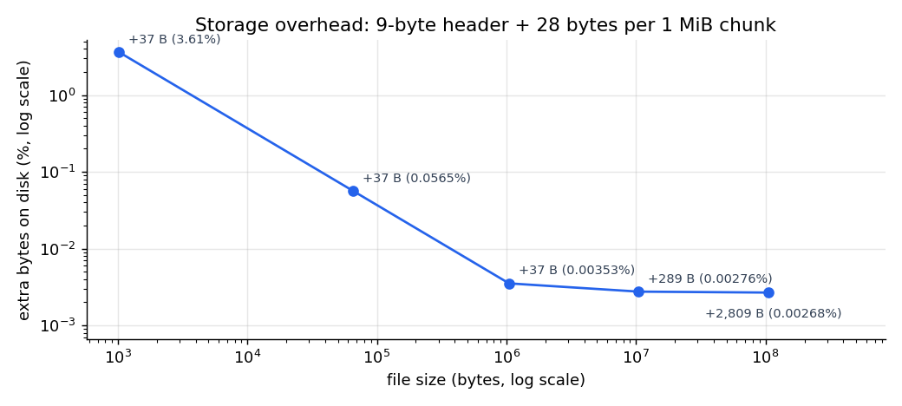
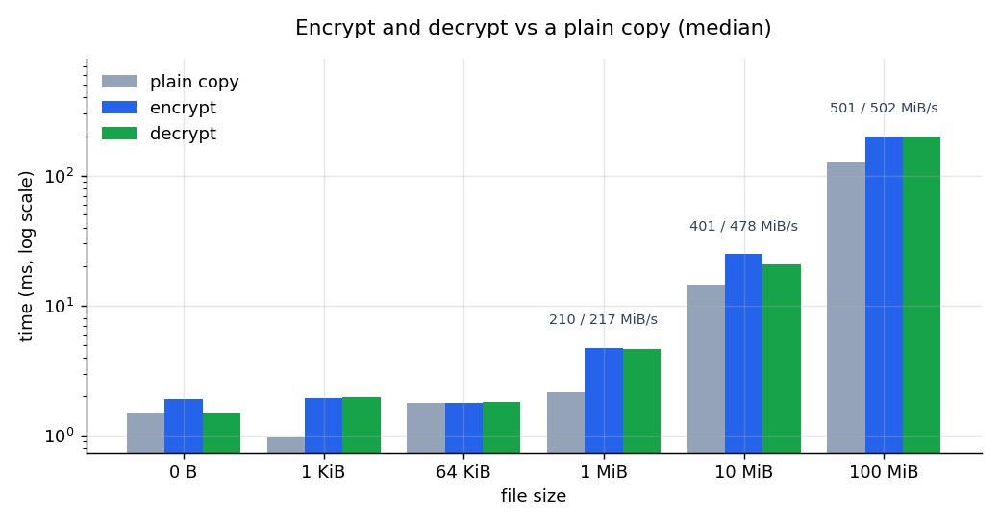
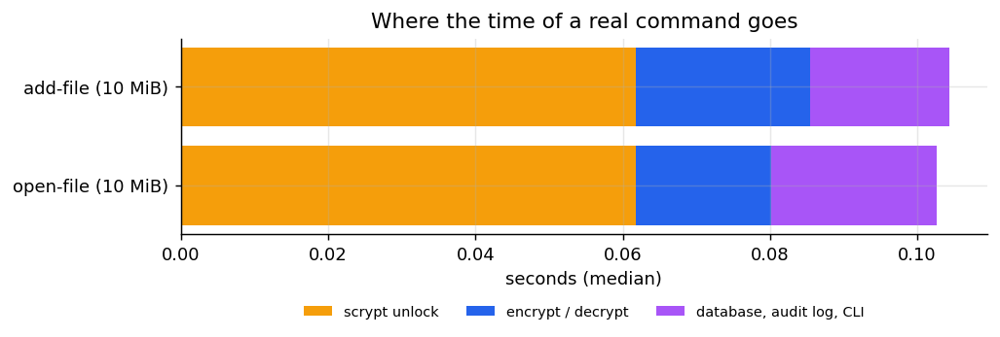
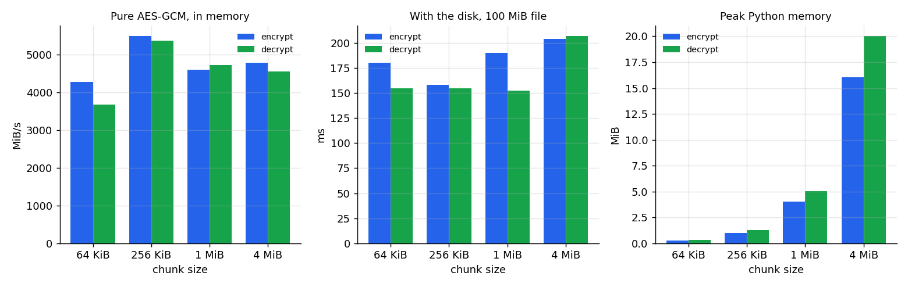

# Benchmark results

Generated by `python scripts/benchmark.py`. Do not edit by hand.

Machine: Intel64 Family 6 Model 154 Stepping 4, GenuineIntel, 12 logical CPUs, Windows 10 (10.0.26200). Python 3.11.9, cryptography 50.0.2 (OpenSSL 4.0.3 29 Sep 2026). Run on 2026-11-13T13:26:13+00:00, profile `full`, median of 5 runs.

## 1. Storage overhead

| File size | Encrypted size | Extra bytes | Extra % | Matches formula |
|---:|---:|---:|---:|:---:|
| 0 B | 37 B | 37 B | - | yes |
| 1 KiB | 1,061 B | 37 B | 3.613% | yes |
| 64 KiB | 65,573 B | 37 B | 0.05646% | yes |
| 1 MiB | 1,048,613 B | 37 B | 0.003529% | yes |
| 10 MiB | 10,486,049 B | 289 B | 0.002756% | yes |
| 100 MiB | 104,860,409 B | 2,809 B | 0.002679% | yes |

Every file also has a 60-byte wrapped data key in the database.

## 2. Encrypt and decrypt speed

| File size | Plain copy (ms) | Encrypt (ms) | Encrypt range | Decrypt (ms) | Decrypt range | Copy MiB/s | Encrypt MiB/s | Decrypt MiB/s |
|---:|---:|---:|---:|---:|---:|---:|---:|---:|
| 0 B | 1.47 | 1.92 | 1.58-2.17 | 1.49 | 1.10-11 | - | - | - |
| 1 KiB | 0.97 | 1.95 | 1.64-2.72 | 1.97 | 1.53-7.68 | - | - | - |
| 64 KiB | 1.78 | 1.79 | 1.61-2.33 | 1.81 | 1.49-11 | - | - | - |
| 1 MiB | 2.16 | 4.76 | 4.14-5.87 | 4.61 | 4.06-8.97 | 462 | 210 | 217 |
| 10 MiB | 15 | 25 | 24-25 | 21 | 20-27 | 683 | 401 | 478 |
| 100 MiB | 126 | 200 | 185-202 | 199 | 181-217 | 795 | 501 | 502 |

The plain copy reads and writes in the same 1 MiB blocks and also calls fsync, so the difference to encrypt/decrypt is the cost of the cryptography, not of the disk. Range = fastest and slowest of the runs.

## 3. Fixed costs per operation

| Operation | Time |
|---|---:|
| Unlock: scrypt (n=32768, r=8, p=1) + check value | 66 ms |
| Wrap one data key (AES-GCM) | 2.3 µs |
| Unwrap one data key | 2.0 µs |
| Append one audit-log entry (one SQLite transaction) | 2.55 ms |
| Verify the audit log (1,000 entries) | 6 ms (5.5 µs per entry) |

## 4. End to end (real CLI commands)

`add-file` and `open-file` on a 10 MiB file, run in-process (Python start-up not included).

| Command | Total | scrypt unlock | Encrypt / decrypt | Database, audit log, CLI |
|---|---:|---:|---:|---:|
| add-file | 104 ms | 62 ms | 24 ms | 19 ms |
| open-file | 103 ms | 62 ms | 18 ms | 23 ms |

## 5. Chunk size

One 100 MiB file, encrypted with each chunk size.

| Chunk size | Chunks | In memory: encrypt MiB/s | In memory: decrypt MiB/s | With disk: encrypt ms (range) | With disk: decrypt ms (range) | Extra bytes | Peak memory encrypt | Peak memory decrypt |
|---:|---:|---:|---:|---:|---:|---:|---:|---:|
| 64 KiB | 1,600 | 4277 | 3668 | 180 (162-242) | 155 (153-168) | 44,809 B | 0.3 MiB | 0.3 MiB |
| 256 KiB | 400 | 5483 | 5357 | 158 (146-173) | 155 (147-159) | 11,209 B | 1.0 MiB | 1.3 MiB |
| 1 MiB | 100 | 4593 | 4715 | 190 (149-225) | 152 (148-154) | 2,809 B | 4.0 MiB | 5.0 MiB |
| 4 MiB | 25 | 4771 | 4540 | 204 (200-233) | 207 (201-222) | 709 B | 16.0 MiB | 20.0 MiB |

*In memory* does exactly the per-chunk work of encrypt/decrypt (random nonce, same AAD, AES-256-GCM) with no file I/O, so it shows the cost of the cryptography alone. *With disk* is the real encrypt_file / decrypt_file: median, with the fastest and slowest run in brackets.

Peak memory is measured with `tracemalloc` in separate runs, so it does not slow the timings.

