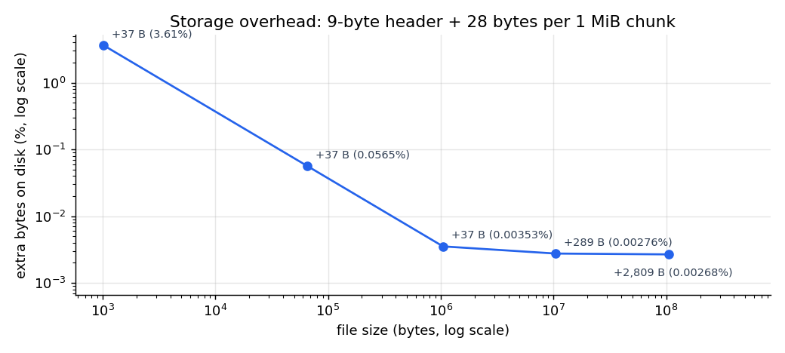
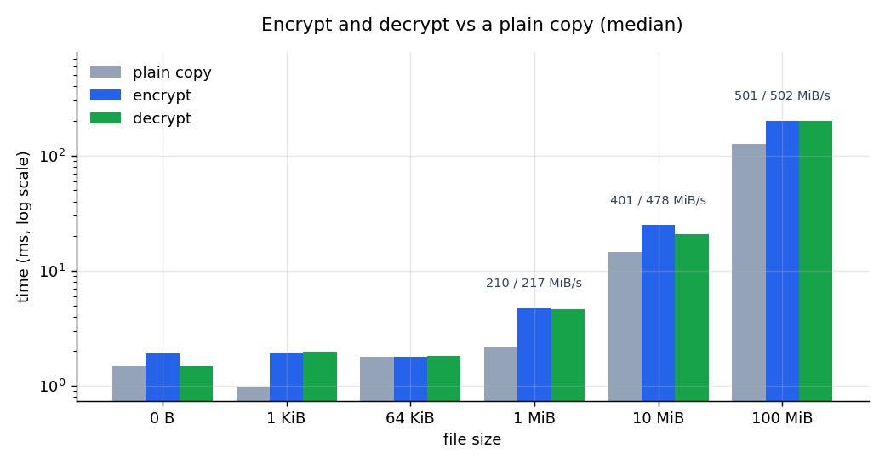
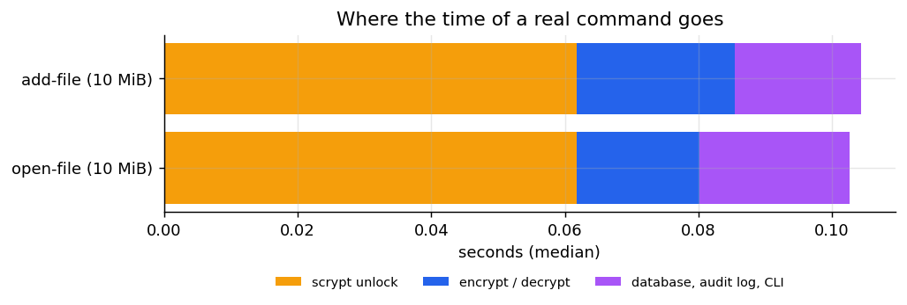
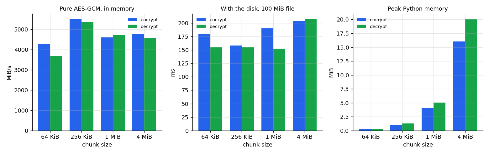

# ChildVault: Overhead Benchmark

 CS3002 Information Security, Fall 2026 | Report chapter for Phase 6

## 1. Goal

Encryption, integrity checks and an audit log all cost something. This chapter measures how much: extra
disk space, extra time to store and open a file, and the fixed cost of every command. It also tests the
one design choice the numbers can settle, the 1 MiB chunk size.

All numbers come from one run of `python scripts/benchmark.py`. The full tables are in
[benchmark/results.md](benchmark/results.md) and every raw measurement is in
[benchmark/results.json](benchmark/results.json).

## 2. Method

| | |
|---|---|
| Machine | Intel CPU (family 6, model 154), 12 logical CPUs, Windows 11 (build 26200) |
| Software | Python 3.11.9, cryptography 50.0.2 on OpenSSL 4.0.3 |
| Repeats | Every timing is the median of 5 runs; the tables also give the fastest and slowest run |
| Data | Random bytes. AES-GCM speed does not depend on the content, and random data cannot be compressed by the disk |
| Sizes | 0 B, 1 KiB, 64 KiB, 1 MiB, 10 MiB, 100 MiB |

**A fair baseline.** The question is what protection costs compared with keeping the file as plaintext.
So every encrypt and decrypt is compared with a plain copy of the same file that reads and writes in the
same 1 MiB blocks and also calls `fsync`, exactly as `encrypt_file` and `decrypt_file` do. Without the
`fsync` the copy would only reach the OS cache and the comparison would flatter the plaintext.

**Separating the cipher from the disk.** Timings that include the disk move around between runs. To see
the cost of the cryptography alone, the benchmark also repeats the exact per-chunk work of
`encrypt_file` (random nonce, the same associated data, AES-256-GCM) on bytes held in memory, with no
file I/O.

Five things are measured:

1. Storage overhead, checked against the file format's exact formula
2. Encrypt and decrypt time against the plain copy
3. Fixed costs: unlocking, key wrapping, audit-log append and verify
4. End to end: the real `add-file` and `open-file` commands
5. Chunk sizes from 64 KiB to 4 MiB

## 3. Results

### 3.1 Storage

An encrypted file is the original plus a 9-byte header plus 28 bytes per chunk (a 12-byte nonce and a
16-byte authentication tag). Every measured file matched this formula to the byte.



| File | Extra bytes | Extra |
|---:|---:|---:|
| 1 KiB | 37 B | 3.6% |
| 64 KiB | 37 B | 0.056% |
| 1 MiB | 37 B | 0.0035% |
| 100 MiB | 2,809 B | 0.0027% |

Each file also gets a 60-byte wrapped data key in the database. For research recordings, which are
megabytes to gigabytes, the storage cost is negligible. It is only visible for tiny files, and even
there it is a fixed 37 bytes.

### 3.2 Encrypt and decrypt time



| File | Plain copy | Encrypt | Decrypt | Encrypt vs copy |
|---:|---:|---:|---:|---:|
| 64 KiB | 1.8 ms | 1.8 ms | 1.8 ms | about the same |
| 1 MiB | 2.2 ms | 4.8 ms | 4.6 ms | 2.2x |
| 10 MiB | 15 ms | 25 ms | 21 ms | 1.7x |
| 100 MiB | 126 ms (795 MiB/s) | 200 ms (501 MiB/s) | 199 ms (502 MiB/s) | 1.6x |

Up to 64 KiB, creating the file and flushing it to disk takes longer than the encryption, so a protected
file costs no more than a plain one. For large files, encrypting or decrypting takes about 1.6 times as
long as copying. In absolute terms a 100 MiB recording is stored or opened in a fifth of a second.

**The cipher is not the bottleneck.** In memory, the same AES-256-GCM work runs at about
4,600 MiB/s (encrypt) and 4,700 MiB/s (decrypt) with 1 MiB chunks, so 100 MiB needs only about 22 ms of
actual cryptography. The measured gap to the plain copy is about 74 ms, more than three times that. The
rest is Python-level work around the cipher: reading one chunk ahead to know which chunk is the last,
joining each nonce and ciphertext into a new 1 MiB buffer before writing it, and writing to a temporary
`.part` file that is renamed at the end. We did not profile this further. It means a faster
implementation would come from less copying, not from a faster cipher.

### 3.3 Fixed costs

| Operation | Time |
|---|---:|
| Unlock: scrypt (n = 32768, r = 8, p = 1) and the check value | 66 ms |
| Wrap one data key | 2.3 µs |
| Unwrap one data key | 2.0 µs |
| Append one audit-log entry | 2.6 ms |
| Verify a 1,000-entry audit log | 5.5 ms (5.5 µs per entry) |

Unlocking is by far the largest fixed cost, and that is deliberate. scrypt with these parameters needs
128 × n × r = 32 MiB of memory and 66 ms of CPU time per attempt, so someone guessing passphrases on this
machine gets about 15 guesses per second per core, and the memory requirement makes large-scale
hardware attacks expensive. The honest user pays this once per command.

Key wrapping costs microseconds, so having a separate key for every file is free in practice. One audit
entry costs about 2.6 ms, almost all of it the SQLite transaction being committed to disk. Verifying the
whole log is linear: about 5.5 seconds for a million entries, far more than a research project will produce.

### 3.4 End to end

`add-file` and `open-file` on a 10 MiB file, through the real command-line code (permission check, audit
logging and database included; Python start-up excluded because it is the same for any Python tool):



| Command | Total | scrypt unlock | Encrypt / decrypt | Database, audit log, CLI |
|---|---:|---:|---:|---:|
| add-file | 104 ms | 62 ms (59%) | 24 ms | 19 ms |
| open-file | 103 ms | 62 ms (60%) | 18 ms | 23 ms |

A user waits about a tenth of a second for a 10 MiB file, and more than half of that is the deliberate
passphrase stretching. The audit log and permission checks add under 25 ms.

### 3.5 Chunk size

The same 100 MiB file was encrypted with four chunk sizes.



| Chunk | Chunks | In memory, encrypt | With disk, encrypt | Extra bytes | Peak memory (decrypt) |
|---:|---:|---:|---:|---:|---:|
| 64 KiB | 1,600 | 4,277 MiB/s | 180 ms | 44,809 B (0.043%) | 0.3 MiB |
| 256 KiB | 400 | 5,483 MiB/s | 158 ms | 11,209 B (0.011%) | 1.3 MiB |
| 1 MiB | 100 | 4,593 MiB/s | 190 ms | 2,809 B (0.0027%) | 5.0 MiB |
| 4 MiB | 25 | 4,771 MiB/s | 204 ms | 709 B (0.0007%) | 20.0 MiB |

- **Speed.** Small chunks pay a fixed cost per call into OpenSSL, so 64 KiB is the slowest in memory.
  From 256 KiB upwards the differences are within run-to-run noise. With the disk, the four sizes are
  within about 50 ms of each other and their order changed between runs (4 MiB was slowest in this run,
  but beat 1 MiB in an earlier one), so the disk numbers do not separate them.
- **Storage.** Overhead falls as chunks grow, but it is tiny at every size.
- **Memory.** Peak memory is about five times the chunk size: the current chunk, the chunk read ahead,
  the ciphertext and the joined record exist at the same time.

**Conclusion.** 1 MiB is a sound choice. Its storage overhead is a quarter of 256 KiB's and its memory
use (5 MiB) is trivial on any computer, while bigger chunks bring no speed and cost memory. In fairness,
256 KiB would have performed just as well, so the choice between those two is a judgement, not a measurement.

## 4. Limits of these measurements

- **One machine, one run.** Within a run the five repeats agree well, and the tables show the fastest
  and slowest. *Between* separate runs the picture is less stable. Files of 1 MiB and below, whose time is
  mostly file creation and `fsync`, varied by up to three times: the 1 MiB plain copy measured 125, 382 and
  462 MiB/s in three runs. The 100 MiB results moved by about 15% (encryption 427 to 501 MiB/s). The
  conclusions above hold in every run; the exact figures should be read as "on the order of".
- **Warm cache.** Each file is read straight after it was written, so reads mostly come from the OS cache.
  Reading from a cold disk would make every column slower, plaintext included.
- **Background activity.** Windows runs antivirus scanning and indexing that can add noise to anything
  touching the disk.
- **Memory figures** come from Python's `tracemalloc`, measured in separate runs so they do not slow the
  timings. They cover Python's buffers, not memory allocated inside OpenSSL.
- **Python start-up** (a few hundred milliseconds for any Python tool) is not included in the end-to-end figures.

## 5. Summary

| Question | Answer |
|---|---|
| How much bigger is an encrypted file? | 37 bytes for small files, 0.0027% for large ones |
| How much slower is storing or opening a file? | About 1.6x a plain copy for large files, no difference up to 64 KiB |
| Is the cipher the bottleneck? | No. AES-GCM runs at about 4.6 GiB/s; the extra time is copying and file handling in Python |
| What does a user wait for? | About 0.1 s per command, mostly the deliberate scrypt unlock |
| Is 1 MiB the right chunk size? | Yes: negligible overhead, 5 MiB of memory, and no faster option |

Protecting the data costs a fraction of a second per command and a few kilobytes per gigabyte, which is
acceptable for a tool that stores research recordings.

## 6. Reproducing

```bash
pip install -r requirements.txt
python scripts/benchmark.py                 # about 30 seconds; rewrites docs/benchmark/
python scripts/benchmark.py --quick         # a few seconds, tiny sizes (used by the test suite)
```
